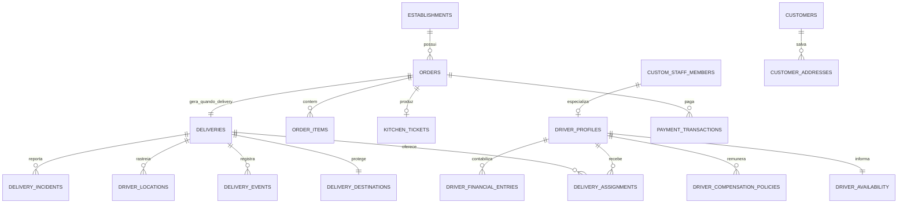

# MasterApp — Fase 2: modelagem do delivery

Status: **modelagem concluída para revisão; nenhuma migration aplicada**.

Este documento define o contrato de dados e a máquina de estados do módulo de delivery. A implementação deve ser incremental e preservar pedidos, cozinha, equipe, pagamentos e autenticação existentes.

## 1. Princípios do modelo

1. `orders` permanece a fonte de verdade do pedido e de seus valores comerciais.
2. `kitchen_tickets` permanece a fonte de verdade da produção na cozinha.
3. `custom_staff_members` permanece o cadastro-base de funcionários.
4. `deliveries` representa somente a operação logística de pedidos com `fulfillment_type = 'delivery'`.
5. Endereço e telefone de entrega ficam separados dos dados operacionais para limitar sua exposição.
6. Toda entidade operacional possui `establishment_id` e RLS multiestabelecimento.
7. Valores monetários continuam em centavos (`integer`/`bigint`), nunca em ponto flutuante.
8. Mudanças de estado críticas ocorrem em funções transacionais no backend, nunca por `update` livre do frontend.
9. Eventos de logística e lançamentos financeiros são históricos imutáveis; correções geram novos registros compensatórios.
10. Funcionário com histórico não é excluído fisicamente: é desativado.

## 2. Entidades existentes reutilizadas

| Entidade atual | Uso no delivery |
|---|---|
| `establishments` | Proprietário de todos os dados do módulo |
| `establishment_members` | Permissões administrativas e operacionais |
| `service_modes` | Ativação/desativação do modo delivery |
| `business_hours` | Horário geral de funcionamento |
| `establishment_settings` | Configurações gerais e tempo-base existente |
| `delivery_zones` | Regras de taxa e mínimo por bairro/zona |
| `customers` | Cliente identificado por estabelecimento e telefone |
| `orders` | Pedido, total, taxa, forma de pagamento e status geral |
| `order_items` | Itens, adicionais, retiradas e observações |
| `kitchen_tickets` | Recebimento, preparo e conclusão da cozinha |
| `custom_staff_members` | Cadastro-base do funcionário motoboy |
| `staff_roles` | Categoria de funcionário; receberá o papel de sistema `driver` |
| `push_subscriptions` | Base do Web Push; será estendida para audiência de motoboy |
| `audit_logs` | Auditoria administrativa e de segurança |
| `cash_registers`, `cash_shifts`, `pos_sales` | Conciliação de pagamentos recebidos no caixa |
| `cash_movements` | Ajustes financeiros existentes, quando aplicável |

Não será criada uma segunda tabela de pedidos, clientes, itens ou funcionários.

## 3. Extensões incrementais em tabelas existentes

### `orders`

Campos existentes reutilizados: `delivery_address`, `delivery_fee_cents`, `payment_method`, `cash_received_cents`, `cash_change_cents`, `tracking_token`.

Alterações planejadas:

- manter `delivery_address` temporariamente para compatibilidade, mas gravar novos pedidos na entidade protegida `delivery_destinations`;
- adicionar `payment_status` somente se a reconciliação confirmar que não existe campo equivalente;
- adicionar `paid_at` somente se não existir equivalente;
- manter o enum atual de `order_status` e mapear a logística para ele, sem espalhar novos estados de delivery em `orders`.

### `staff_roles`

- ampliar `system_key` para aceitar `driver`;
- criar exatamente um papel de sistema “Motoboy” por estabelecimento;
- não duplicar papéis personalizados existentes com o mesmo significado.

### `push_subscriptions`

- incluir audiência `driver`;
- vincular a assinatura ao `user_id` e ao estabelecimento;
- manter assinatura do cliente limitada ao pedido rastreado.

## 4. Novas entidades

### 4.1 `delivery_settings`

Uma linha por estabelecimento.

| Campo | Tipo conceitual | Regra |
|---|---|---|
| `id` | uuid | PK |
| `establishment_id` | uuid | FK única para `establishments` |
| `fee_model` | enum/text | `fixed`, `neighborhood`, `distance` |
| `fixed_fee_cents` | integer | >= 0 |
| `free_delivery_above_cents` | integer nullable | >= 0 |
| `max_radius_meters` | integer nullable | > 0 |
| `dispatch_mode` | enum/text | `fair_queue`, `nearest`, `lowest_load`, `smart`, `manual` |
| `acceptance_timeout_seconds` | smallint | 10, 15, 20 ou 30; padrão 15 |
| `max_active_deliveries_per_driver` | smallint | padrão 1 |
| `location_interval_seconds` | smallint | limite seguro, inicialmente 20–60 s |
| `pickup_code_required` | boolean | padrão true |
| `delivery_pin_mode` | enum/text | `never`, `always`, `first_order`, `above_amount`, `risk` |
| `delivery_pin_threshold_cents` | integer nullable | usado no modo por valor |
| `grouped_delivery_enabled` | boolean | padrão false |
| `high_demand_enabled` | boolean | estado operacional |
| `high_demand_extra_fee_cents` | integer | taxa do cliente |
| `high_demand_driver_bonus_cents` | integer | repasse do motoboy |
| `created_at`, `updated_at` | timestamptz | auditoria temporal |

`service_modes.delivery_enabled` continua sendo a chave que liga/desliga o serviço. Esta tabela configura como ele funciona.

### 4.2 `delivery_distance_bands`

Faixas para cobrança por distância.

- `id`, `establishment_id`;
- `min_distance_meters`, `max_distance_meters`;
- `fee_cents`, `active`, `sort_order`;
- restrição de faixa válida e teste de sobreposição na função administrativa;
- índice `(establishment_id, active, min_distance_meters)`.

`delivery_zones` continua responsável pelo modelo por bairro. A Fase 3 poderá acrescentar nome normalizado/aliases à zona, após confirmar os dados reais.

### 4.3 `customer_addresses`

Endereços salvos somente para cliente autenticado.

- `id`, `establishment_id`, `customer_id`, `owner_user_id`;
- `label` (`Casa`, `Trabalho`, `Outro`);
- CEP, rua, número, complemento, bairro, cidade, UF e referência;
- latitude, longitude e precisão, quando autorizadas;
- `is_default`, `created_at`, `updated_at`, `deleted_at`.

Até existir autenticação de cliente, o checkout usa apenas o endereço-snapshot do pedido e não expõe CRUD anônimo de endereços salvos.

### 4.4 `driver_profiles`

Extensão 1:1 do cadastro de funcionário.

| Campo | Regra |
|---|---|
| `custom_staff_member_id` | FK única; identidade de RH existente |
| `establishment_id` | FK e parte da validação de tenant |
| `user_id` | FK única para `auth.users`, nullable até ativar convite |
| `phone` | normalizado para acesso operacional |
| `cpf_hash`, `cpf_last4` | opcionais; evitar CPF integral em texto aberto |
| `vehicle_type`, `vehicle_model`, `vehicle_plate` | opcionais |
| `approval_status` | `pending`, `approved`, `blocked` |
| `active` | soft delete/bloqueio operacional |
| `last_access_at` | último acesso |

Nome, foto, tipo de contratação, data de diária, turno e ciclo de pagamento permanecem em `custom_staff_members`.

### 4.5 `driver_access_links`

- `id`, `establishment_id`, `driver_profile_id`;
- `token_hash` único — o token original nunca é persistido;
- `expires_at`, `used_at`, `revoked_at`, `created_by`, `created_at`;
- somente um convite válido por motoboy;
- uso atômico com `FOR UPDATE`.

### 4.6 `driver_availability`

Uma linha atual por motoboy.

- `driver_profile_id` PK/FK;
- `establishment_id`;
- `status`: `offline`, `available`, `offered`, `collecting`, `delivering`, `paused`, `blocked`;
- `available_since`, `paused_at`, `pause_reason`;
- `last_completed_at`, usado no retorno ao fim da fila;
- `active_delivery_count` validado pelo backend;
- `last_location_at`, `updated_at`.

A ordem da fila justa usa `available_since`, depois `last_completed_at`, depois `driver_profile_id` como desempate estável.

### 4.7 `deliveries`

Uma linha por pedido de delivery.

| Campo | Regra |
|---|---|
| `id` | uuid PK |
| `establishment_id` | obrigatório |
| `order_id` | FK única para `orders` |
| `status` | máquina logística padronizada |
| `distance_meters` | nullable até cálculo |
| `estimated_duration_seconds` | nullable |
| `customer_delivery_fee_cents` | snapshot da taxa cobrada |
| `driver_payout_cents` | snapshot do repasse |
| `logistics_margin_cents` | taxa menos repasse, calculado no servidor |
| `pickup_code_hash` | código de retirada com hash |
| `pickup_code_expires_at` | validade operacional |
| `pickup_code_attempts` | proteção contra tentativa excessiva |
| `delivery_pin_hash` | PIN de entrega com hash |
| `delivery_pin_required` | snapshot da regra aplicada |
| `delivery_pin_attempts` | proteção contra tentativa excessiva |
| `ready_at`, `dispatch_started_at` | tempos de despacho |
| `picked_up_at`, `arrived_at`, `delivered_at` | prova temporal |
| `canceled_at`, `failed_at` | encerramentos alternativos |
| `created_at`, `updated_at` | auditoria |

Não será guardado código/PIN em texto aberto. O código exibido à loja/cliente será entregue apenas pelo fluxo autorizado.

### 4.8 `delivery_destinations`

Separada de `deliveries` para proteção de dados pessoais.

- `delivery_id` PK/FK;
- `establishment_id`;
- destinatário e telefone;
- CEP, rua, número, complemento, bairro, cidade, UF e referência;
- latitude/longitude confirmadas;
- fonte da geocodificação e precisão;
- snapshot imutável do endereço utilizado no pedido.

O frontend do motoboy não recebe `select` direto nesta tabela. Uma RPC libera os dados somente ao motoboy aceito, após a retirada validada, ou ao admin autorizado.

### 4.9 `delivery_assignments`

Cada chamada de motoboy é uma tentativa separada.

- `id`, `establishment_id`, `delivery_id`, `driver_profile_id`;
- `status`: `offered`, `accepted`, `rejected`, `expired`, `canceled`, `completed`;
- `offer_rank`, `dispatch_score`, `score_breakdown`;
- `offered_at`, `expires_at`, `responded_at`, `accepted_at`, `completed_at`;
- `rejection_reason`, `canceled_reason`;
- `created_by` (`system` ou usuário admin, representado por colunas de ator).

Índices/restrições essenciais:

- apenas uma oferta aberta por delivery;
- apenas uma atribuição aceita por delivery;
- no modo padrão, apenas uma oferta aberta por motoboy;
- índice `(establishment_id, status, offered_at)`;
- índice `(driver_profile_id, status, offered_at desc)`.

### 4.10 `delivery_events`

Linha do tempo append-only.

- `id bigint identity` para inserção sequencial;
- `establishment_id`, `delivery_id`;
- `event_type` padronizado;
- `from_status`, `to_status`;
- ator: `actor_type`, `actor_user_id`, `actor_driver_id`;
- `metadata` sem credenciais, PIN, código ou endereço completo;
- `occurred_at`.

Não há `UPDATE` ou `DELETE` pelo cliente da aplicação.

### 4.11 `driver_locations`

Histórico de alta escrita durante o trabalho.

- `id bigint identity`;
- `establishment_id`, `driver_profile_id`, `delivery_id` nullable;
- latitude/longitude `double precision`;
- `accuracy_meters`, `heading_degrees`, `speed_mps`;
- `captured_at`, `received_at`;
- `source` e `session_id` quando necessário;
- retenção inicial proposta: 30 dias para pontos brutos; eventos de retirada/entrega preservam os pontos de prova necessários.

Índices: `(driver_profile_id, captured_at desc)` e parcial `(delivery_id, captured_at desc) where delivery_id is not null`.

### 4.12 `delivery_incidents`

- `id`, `establishment_id`, `delivery_id`, `driver_profile_id`;
- tipo: cliente ausente, endereço incorreto, pagamento, veículo, acidente, retorno, outro;
- descrição, status (`open`, `resolved`, `canceled`), resolução;
- criador, responsável, timestamps;
- anexos ficam em bucket privado e a tabela guarda somente o caminho.

### 4.13 `driver_compensation_policies`

Política financeira versionada por vigência.

- `driver_profile_id`, `establishment_id`;
- modelo: por entrega, diária, diária + entrega, salário, salário + comissão, personalizado;
- valor da diária, por entrega, salário, comissão;
- `effective_from`, `effective_to`;
- nunca atualizar uma política usada: encerrar a vigência e criar outra.

### 4.14 `driver_financial_entries`

Razão financeira append-only.

- `id bigint identity`, `establishment_id`, `driver_profile_id`;
- `delivery_id` nullable;
- tipo: `delivery_payout`, `daily_rate`, `salary`, `commission`, `bonus`, `fuel`, `rain`, `night`, `adjustment`, `reversal`;
- `amount_cents` assinado;
- motivo obrigatório para ajuste/reversão;
- política aplicada, período de competência, ator e timestamps;
- chave idempotente para impedir repasse duplicado da mesma entrega.

### 4.15 `payment_transactions`

Contrato neutro para pagamento online futuro.

- `order_id`, `establishment_id`;
- gateway, ID externo, idempotency key;
- método, status, valor e moeda;
- bandeira/últimos quatro somente quando fornecidos pelo gateway;
- vencimento do PIX, confirmação e timestamps;
- payload sensível nunca é armazenado;
- webhooks são deduplicados pelo ID externo do evento.

A escolha do gateway continua pendente e não bloqueia dinheiro/cartão/PIX na entrega.

## 5. Relações principais

## 6. Máquina de estados

### 6.1 Status do pedido existente

`orders.status` continua com:

`new → confirmed → preparing → ready → out_for_delivery → completed`

Cancelamento é permitido conforme regras operacionais e registra evento/auditoria.

### 6.2 Status logístico

`deliveries.status`:

- `pending`: pedido ainda em pagamento/preparo;
- `ready_for_dispatch`: cozinha pronta e pagamento autorizado quando online;
- `searching_driver`: despacho procurando motoboy;
- `driver_assigned`: aceitação confirmada atomicamente;
- `driver_to_pickup`: motoboy indo ao estabelecimento;
- `picked_up`: código de retirada validado e custódia transferida;
- `on_route`: saiu para o destino;
- `arrived`: motoboy informou “Estou na porta”;
- `delivered`: PIN/confirmação validada;
- `returning_to_store`: falha após retirada exige retorno;
- `returned_to_store`: retorno confirmado pelo estabelecimento;
- `failed`: operação encerrada com ocorrência;
- `canceled`: cancelada antes da transferência de custódia.

### 6.3 Transições permitidas

| Estado atual | Próximos estados válidos | Condição principal |
|---|---|---|
| `pending` | `ready_for_dispatch`, `canceled` | cozinha pronta + pagamento válido |
| `ready_for_dispatch` | `searching_driver`, `canceled` | início do despacho |
| `searching_driver` | `driver_assigned`, `failed`, `canceled` | oferta aceita ou encerramento |
| `driver_assigned` | `driver_to_pickup`, `searching_driver`, `canceled` | confirmação ou perda da atribuição |
| `driver_to_pickup` | `picked_up`, `searching_driver`, `canceled` | código de retirada ou reatribuição |
| `picked_up` | `on_route`, `returning_to_store` | custódia já transferida |
| `on_route` | `arrived`, `returning_to_store` | chegada ou incidente |
| `arrived` | `delivered`, `returning_to_store` | PIN/confirmação ou falha |
| `returning_to_store` | `returned_to_store`, `failed` | confirmação do retorno |
| finais | nenhum | `delivered`, `returned_to_store`, `failed`, `canceled` |

É proibido voltar de `picked_up`, `on_route` ou `arrived` para cozinha/preparo. Nesses casos, qualquer problema abre ocorrência e fluxo de retorno.

### 6.4 Sincronização com cozinha e pedido

| Evento | `kitchen_tickets` | `deliveries` | `orders` |
|---|---|---|---|
| Pedido criado | `received` | `pending` | `new` |
| Cozinha inicia | `preparing` | `pending` | `preparing` |
| Cozinha conclui | `ready` | `ready_for_dispatch` | `ready` |
| Motoboy retira | permanece `ready` | `picked_up`/`on_route` | `out_for_delivery` |
| Entrega confirmada | não muda | `delivered` | `completed` |

Para delivery, a cozinha nunca marca o pedido como entregue. A conclusão pertence ao fluxo de entrega.

## 7. Operações transacionais do backend

Todas as funções abaixo devem validar o tenant, o ator, o estado atual e registrar `delivery_events` na mesma transação.

### Checkout e taxa

- `quote_delivery(slug, address, cart_subtotal)`: valida zona/raio e calcula taxa no servidor;
- `place_public_order_v2(...)`: cria pedido, destino, delivery, itens e ticket de cozinha atomicamente;
- o cliente não envia um valor de taxa confiável; o backend recalcula.

### Despacho

- `start_delivery_dispatch(delivery_id)`;
- `offer_next_driver(delivery_id)` usando fila/score e `FOR UPDATE SKIP LOCKED`;
- `accept_delivery_assignment(assignment_id)` com compare-and-swap;
- `reject_delivery_assignment(assignment_id, reason)`;
- `expire_delivery_offer(assignment_id)` idempotente.

### Retirada e entrega

- `verify_pickup_code(delivery_id, code)`;
- `start_delivery_route(delivery_id)`;
- `mark_driver_arrived(delivery_id)`;
- `verify_delivery_pin(delivery_id, pin)`;
- `complete_delivery_without_pin(delivery_id, reason)` somente com regra/autorização;
- `report_delivery_incident(delivery_id, type, description)`;
- `confirm_return_to_store(delivery_id)`.

### Localização

- `update_driver_location(...)` valida motoboy autenticado, disponibilidade/entrega ativa, frequência e limites geográficos;
- `get_customer_delivery_tracking(tracking_token)` retorna posição aproximada e dados mínimos;
- `get_driver_delivery_detail(delivery_id)` libera endereço completo apenas após retirada validada.

## 8. Garantia contra dois motoboys aceitarem a mesma entrega

O aceite seguirá esta ordem fixa dentro de uma transação curta:

1. bloquear a atribuição pelo ID (`FOR UPDATE`);
2. bloquear a entrega correspondente;
3. bloquear a disponibilidade do motoboy;
4. confirmar `assignment.status = 'offered'` e `expires_at > now()`;
5. confirmar que a entrega ainda está em busca e não possui atribuição aceita;
6. atualizar a atribuição para `accepted` com condição no estado anterior;
7. atualizar entrega e disponibilidade;
8. inserir evento;
9. confirmar transação.

Além do lock, um índice único parcial impede mais de uma atribuição aceita. Assim, mesmo duas requisições no mesmo milissegundo resultam em um único vencedor; a outra recebe resposta de corrida já atribuída.

Chamadas externas de mapas, pagamentos ou push nunca ocorrem dentro da transação que segura locks.

## 9. RLS e privacidade

### Administrador/gerente

- acesso ao tenant confirmado por `establishment_members`;
- CRUD de configurações e equipe;
- leitura operacional e financeira;
- ações críticas somente via RPC auditada.

### Cozinha

- lê somente identificação, itens e informações necessárias para preparo;
- não recebe endereço completo ou financeiro administrativo;
- sinaliza cozinha pronta pela função existente adaptada, que inicia despacho.

### Motoboy

- lê o próprio perfil, disponibilidade, ofertas e atribuições;
- antes do código de retirada: recebe somente loja, número do pedido, distância, taxa e instruções de coleta;
- após retirada: RPC libera endereço, telefone e rota da entrega ativa;
- insere apenas a própria localização e ocorrências;
- não acessa produtos, preços administrativos, outros motoboys ou faturamento geral.

### Cliente

- acompanha um único pedido por `tracking_token` de alta entropia;
- não faz `select` direto em `deliveries`, destinos ou localização bruta;
- recebe posição aproximada e somente durante a entrega ativa.

### Privilégios

- RLS em todas as novas tabelas `public`;
- primeiro `revoke all from anon, authenticated`, depois grants mínimos;
- políticas separadas por operação;
- funções privilegiadas no schema `private`, `search_path = ''`, execução revogada de `PUBLIC`;
- views expostas somente com `security_invoker = true`;
- colunas de tenant e ownership sempre indexadas.

## 10. Realtime e notificações

Tabelas candidatas à publicação `supabase_realtime`:

- `deliveries`;
- `delivery_assignments`;
- `driver_availability`;
- opcionalmente eventos operacionais filtrados.

`driver_locations` não deve ser transmitida indiscriminadamente por Postgres Changes. Para escala e privacidade, a posição do cliente deve usar canal controlado/Broadcast ou RPC periódica com posição aproximada.

Não será criado nem alterado objeto dentro do schema `realtime`; apenas a publicação `supabase_realtime` será configurada. O sistema atual de Web Push será estendido com eventos idempotentes para motoboy, cliente e admin.

## 11. Índices obrigatórios

- toda FK recebe índice quando não estiver coberta por índice composto;
- `deliveries (establishment_id, status, created_at desc)`;
- `deliveries (order_id)` único;
- `delivery_assignments (delivery_id, status, offered_at desc)`;
- `delivery_assignments (driver_profile_id, status, offered_at desc)`;
- índices parciais para oferta aberta e aceite ativo;
- `driver_availability (establishment_id, status, available_since)`;
- `delivery_events (delivery_id, occurred_at, id)`;
- `driver_locations (driver_profile_id, captured_at desc)`;
- `delivery_incidents (establishment_id, status, created_at desc)`;
- `driver_financial_entries (driver_profile_id, competence_date desc)`;
- chaves únicas idempotentes em pagamento, repasse e notificação.

Paginação de históricos será por cursor (`occurred_at`, `id`), não por offset em grandes volumes.

## 12. Ordem das futuras migrations

Nenhuma destas migrations existe ou foi aplicada nesta fase.

1. **Reconciliação/baseline**: comparar schema publicado, arquivos locais e histórico remoto.
2. **Delivery core**: enums/checks, `delivery_settings`, faixas, perfis, deliveries, destinos e eventos.
3. **Segurança/RLS**: grants mínimos, policies, funções privadas e testes pgTAP.
4. **Checkout**: endereço estruturado, cálculo de taxa e criação atômica.
5. **Despacho**: disponibilidade, atribuições, fila e concorrência.
6. **Custódia**: código de retirada, PIN, incidentes e retorno.
7. **Localização**: posições, retenção e tracking controlado.
8. **Financeiro**: políticas e lançamentos de repasse.
9. **Realtime/push**: publicação e eventos idempotentes.
10. **Pagamentos online**: somente após escolher gateway multiestabelecimento.

Cada migration será criada pelo Supabase CLI, revisada antes de aplicação, testada e acompanhada por verificação de advisors.

## 13. Decisões adiadas que não bloqueiam o núcleo

- gateway de pagamento online e modelo de conta por estabelecimento;
- provedor de CEP/geocodificação/rotas;
- PostGIS, que só será considerado após medir necessidade real;
- autenticação opcional do cliente para endereços salvos;
- agrupamento automático de entregas, inicialmente apenas sugestão;
- algoritmo Smart Dispatch avançado, após haver dados operacionais reais.

## 14. Critérios de aceite da modelagem

- não duplica pedidos, clientes, cozinha ou funcionários;
- separa pedido, produção, logística e financeiro;
- mantém isolamento por estabelecimento;
- impede aceite simultâneo por dois motoboys;
- não expõe endereço antes da retirada;
- preserva custódia após retirada;
- diferencia taxa cobrada, repasse e margem logística;
- todos os estados têm transições válidas no backend;
- histórico crítico é imutável e auditável;
- nenhuma migration ou dado de produção foi alterado nesta fase.
